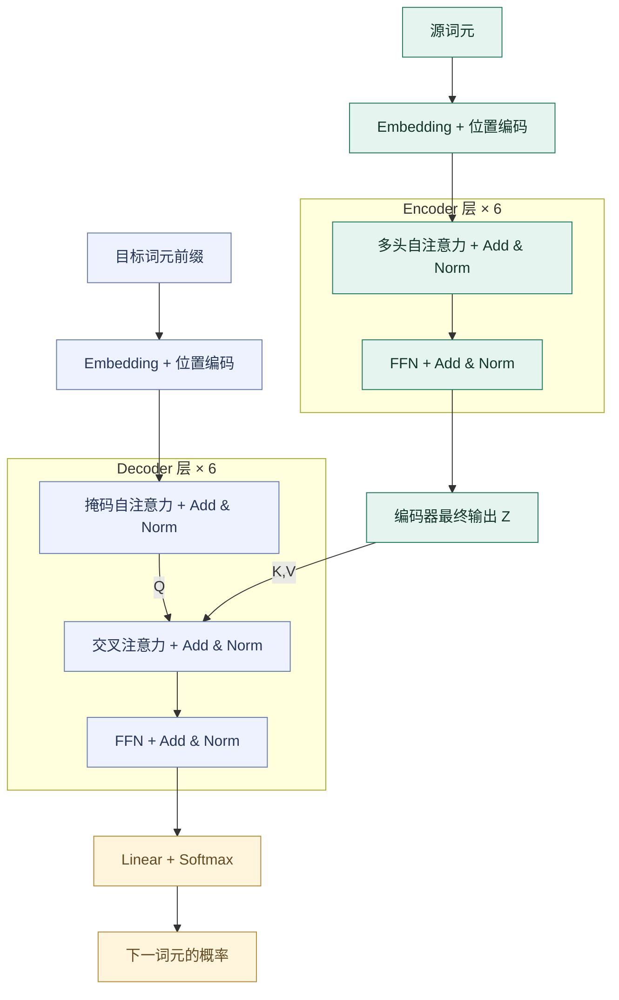

# Attention Is All You Need · 格式片段

<!-- 本文件仅演示组织与格式，不是完整逐段精读或全量推导。范围说明见仓库 README。 -->

# First Time

## 1.Abstract
- 问题： 循环网络沿词元逐步计算，限制同一序列内部的训练并行度。
- 动机： 注意力能够直接联系远处位置，但当时通常仍与循环网络配合。
- 方法： 用多头注意力组织 encoder–decoder，移除循环与卷积主干。
- 结果： big 模型在 WMT 2014 英德、英法测试中分别达到 28.4、41.0 BLEU。
- 意义： 在这些翻译设置下，兼顾质量与训练效率；8 张 P100 上训练 big 约 3.5 天。

## 2.Conclusion
- 贡献： 将自注意力、交叉注意力、FFN 与位置编码组合成完整 Transformer。
- 结果： 英德超过表中最佳先前集成；英法超过先前单模型，仍低于表中最佳集成。
- 展望： 其他模态、局部注意力、更少串行步骤的生成，均是后续研究方向。（§7）

# Second Time

## 1.Notation & Parameters
以下选取本片段使用的主线记号；完整导读应按实际正文补齐重点表，局部符号就地解释。

| 符号/参数 | 含义与作用 | 关键设定/约束 |
|---|---|---|
| $Q$ | 查询矩阵，用于与键计算匹配 | 交叉注意力中来自解码器 |
| $K$ | 键矩阵 | 交叉注意力中来自编码器输出 |
| $V$ | 值矩阵，被注意力权重加权汇聚 | 与键的位置数一致 |
| $d_{\mathrm{model}}$ | 模型隐藏表示维度 | base 为 512 |
| $d_k$ | 每头键与查询的维度，同时决定缩放量 | base 为 64 |
| $d_v$ | 每头值的维度 | base 为 64 |
| $M$ | 讲解辅助：显式表示因果掩码 | 允许位置 0，禁止位置 $-\infty$；原式 (1) 未写出 |
| $W_1,W_2,b_1,b_2$ | FFN 两层仿射变换参数 | base 的特征维度为 $512\rightarrow2048\rightarrow512$ |
| $\beta_1,\beta_2$ | Adam 一阶与二阶矩估计系数 | 0.9 与 0.98 |
| $\epsilon$ | Adam 数值稳定常数 | $10^{-9}$ |

## 2.Introduction & Background
原文章节：§1–2。
瓶颈：$h_t=f(h_{t-1},x_t)$ 带来序列内串行依赖。已有卷积路线可以并行，但远处位置通常需经过多层连接。
创新定位： 用注意力完成序列位置之间的主要信息交互，构造完整序列转导架构；注意力与自注意力已有先行工作。

## 3.Encoder and Decoder
原文章节：§3.1。
图表对应：[Fig1 精读](#fig1)。
base：编码器、解码器各 6 层，$d_{\mathrm{model}}=512$，8 个头，每头 $d_k=d_v=64$；FFN 为 $512\rightarrow2048\rightarrow512$。

依据 Fig 1 重新绘制：同一层子结构重复堆叠，图中合并了残差、dropout 与 LayerNorm；Add & Norm 是子层输出经 dropout 后与输入相加，再归一化。
训练与推理： 训练时输入右移，因果掩码遮住未来位置，可同时预测多个位置；推理时仍逐词生成。交叉注意力的 $Q$ 来自解码器，$K,V$ 来自编码器。

## 4.Attention
原文章节：§3.2。
图表对应：[Fig2 精读](#fig2)。
$Q$ 查询、$K$ 匹配、$V$ 内容：
$$
\operatorname{Attention}(Q,K,V)
=\operatorname{softmax}\left(\frac{QK^\top}{\sqrt{d_k}}+M\right)V.
$$
$M$ 为讲解中显式写出的掩码：允许位置为 0，禁止位置为 $-\infty$；原文公式 (1) 未写 $M$，正文说明了 masking。多头分别投影、计算，再沿特征维拼接。

## 5.FFN, Embedding and Positional Encoding
原文章节：§3.3–3.5。
FFN 的计算为 $\operatorname{FFN}(x)=\max(0,xW_1+b_1)W_2+b_2$。
FFN 逐位置加工特征，同一层各位置共享参数。入口 embedding 将编号变为向量，出口 Linear + Softmax 产生词表概率。
固定正弦、余弦位置编码与 embedding 相加。作者提出它可能适用于更长序列，但本文实验未验证长度外推。

## 6.Why Self-Attention
原文章节：§4。
图表对应：[Table1 精读](#table1)。
比较三件事：每层计算量、串行操作数、远距离传播路径。自注意力缩短路径并提高并行度，全局注意力仍需计算大量位置关系；局部注意力可以降低成本，但会增加跨远处位置的路径。

## 7.Training
原文章节：§5。
- 数据： WMT 2014；英德约 450 万句对，BPE 共享词表约 37,000。按近似长度组批，每批源/目标各约 25,000 词元。
- 优化： Adam，$\beta_1=0.9,\ \beta_2=0.98,\ \epsilon=10^{-9}$；4000 步 warmup 后，学习率按步数平方根倒数下降。
- 正则化： base 的 dropout、标签平滑均为 0.1；标签平滑可使 BPE 词元级 PPL 变差，却改善 BLEU。
- 资源： 8 张 P100；base 10 万步约 12 小时，big 30 万步约 3.5 天。

## 8.Figure & Table

#### Fig1:
- 核心架构图。编码器形成源句表示；解码器读取目标前缀和源句，再预测下一词元。箭头表示信息流。

#### Fig2:
- 左图展示“匹配 → 缩放 → softmax → 汇聚”，右图展示多个投影子空间的并行注意力与拼接。

#### Table1:
- 比较计算量、串行操作和最长路径。全局自注意力路径短，核心计算量仍为 $O(n^2d)$。

#### Table2:
- big 的英德成绩比表中最佳先前结果高 2.04 BLEU；英法 41.0 比最佳先前单模型 40.56 高 0.44，低于集成 41.29。训练成本为估算值。

#### Table3:
- 多头与适度 dropout 有益，增大深度或头数并非持续获益；位置编码两种方案接近。指标来自 newstest2013 开发集，未做检查点平均；不能直接与 Table 2 测试成绩混比。

# Overall Review

- 贡献： 给出可并行训练的注意力序列转导架构及缩放点积、多头设计。
- 优点： 信息路径短，矩阵运算清晰；整体翻译结果与部分消融提供支持。
- 不足： 长序列注意力成本高，生成仍串行；缺少多次运行统计和长度外推验证。
- 定位： 继承 encoder–decoder、已有注意力及训练组件，改变序列主干。
- 延伸： 固定与可学习位置编码超出训练长度后如何表现？待验证。
- 适合： 已接触神经网络训练，希望理解注意力数据流与实验边界的读者。
