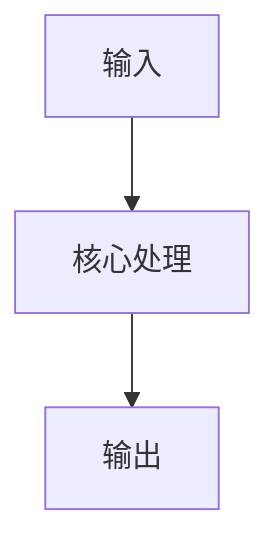

# 论文题名

# First Time

## 1.Abstract
- **问题：** 核心研究问题。
- **动机：** 已有方法的主要缺口。
- **方法：** 本文的核心方案。
- **结果：** 关键结果及比较条件。
- **意义：** 在证据范围内说明价值。

## 2.Conclusion
- **贡献：** 主要贡献。
- **结果：** 已验证的结论。
- **展望：** 作者计划或待验证方向。
没有独立结论时，替换为实际结构及已确定的替代/跳过安排。

## 3.Figure & Table
按原文出现顺序增删下列图表条目；有原编号则沿用，没有原编号则按出现顺序为图、表分别从 1 连续编号。每个图表标题仅含编号及冒号，不追加英文题意，标题下一行直接接笔记，正文段落之间不留空行，图表正文末尾下一行直接接下一标题，不留空行；其他小节正文末尾保留一行空行。最重要图表将完整编号及冒号在四级标题中红色高亮。First Time 的所有二级章节按实际输出顺序从 1 连续编号。全文不添加原文页码、页数或页码范围备注，必要时仅用章节、公式号或图表号定位。

#### Fig1:
- 核心机制或证据及必要边界；说明选择这张图的理由。
#### Table1:
- 关键结果、比较条件及必要边界。
# Second Time

## 1.Introduction / Background
研究背景、瓶颈与创新定位。

## 2.Method
使用论文实际的英文章节标题替换 Method；非英文原标题译为英文，中文释义放在正文中。原标星的重点章节使用红色高亮，例如 `## 2.The Architecture`，按当前分组中的连续排序号与实际标题替换。
输入 → 核心处理 → 输出；保留理解必需的公式与符号。只有长公式使用独立的 `$$` 公式块，其他数学内容使用段中公式，例如 $y=f(x)$；替换为论文实际内容。Markdown 表格前保留一行空行。表格后仍有正文说明时，也保留一行空行作为块边界，避免说明被解析成额外表格行；表格后直接接下一图表标题时不补空行。

把示意替换为论文实际结构；图旁说明简化项。

## 3.Other Sections
按原文结构增删，并用实际英文章节标题替换 Other Sections；所有章节和重要小节均使用二级标题，在 Second Time 中重新从 1 连续编号。每节 1–3 个短要点；保留关键分析或训练设置。

# Overall Review

- **贡献：** 核心新增内容。
- **优点：** 有价值的设计及证据。
- **不足：** 限制与缺少的验证。
- **定位：** 与先行工作的关系。
- **延伸：** 一个待验证的问题或方向。
- **适合：** 阅读背景与目标。
